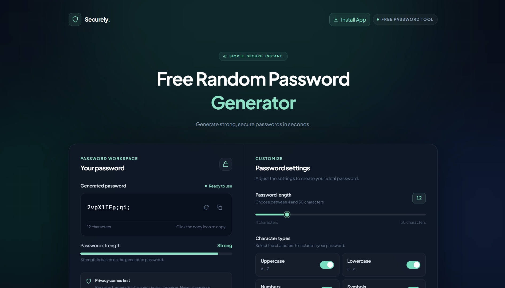

# Securely — Password Generator

A modern, privacy-focused password generator built with React and TypeScript. Securely lets users generate strong, customizable passwords with a clean interface, password strength feedback, and an offline-ready experience powered by Progressive Web App (PWA) technology.

## Preview



## 🔗 Links

- **Live Demo:** [View Website](YOUR_VERCEL_DEPLOYMENT_URL)

## ✨ Features

- **Secure Password Generation** — Generates passwords using the browser's cryptographically secure random number generator.
- **Customizable Passwords** — Control password length and character types.
- **Password Strength Indicator** — Visual feedback for generated password strength.
- **One-Click Copy** — Copy generated passwords directly to the clipboard.
- **Progressive Web App (PWA)** — Installable application with a standalone experience.
- **Offline Support** — Generate passwords and use core functionality without an internet connection.
- **App Update Notifications** — Notifies users when a new version is available.
- **Responsive Design** — Optimized for desktop, tablet, and mobile devices.
- **Privacy-Focused** — Password generation happens locally in the browser.

## 🛠️ Tech Stack

- **React.js** — Component-based UI development
- **TypeScript** — Type safety and maintainable code
- **Tailwind CSS v4** — Utility-first styling and responsive layouts
- **Vite** — Development server and production build
- **Zustand** — State management
- **Framer Motion** — Animations and interactions
- **React Icons** — Icon library
- **Vite PWA Plugin & Workbox** — PWA installation, service worker, and offline caching
- **Web Crypto API** — Cryptographically secure random number generation

## 🚀 Getting Started

Follow these steps to run the project locally.

### Prerequisites

- Node.js
- npm

### Installation

1. Clone the repository:

   ```bash
   git clone YOUR_REPOSITORY_URL
   ```

2. Navigate to the project directory:

   ```bash
   cd password-generator
   ```

3. Install dependencies:

   ```bash
   npm install
   ```

4. Start the development server:

   ```bash
   npm run dev
   ```

5. Open the local URL provided by Vite in your browser.

### Production Preview

To test the production build, including PWA functionality:

```bash
npm run build
npm run preview
```

## 📱 PWA Support

Securely is built as a Progressive Web App, providing an installable and offline-capable experience.

- Install the application on supported devices.
- Launch in standalone mode without the browser interface.
- Generate passwords while offline.
- Cache application assets for offline access.
- Receive update notifications when a new version is available.

## 👨‍💻 About Me

Hey, I'm Abdullah! I'm a web developer who enjoys building websites and web apps, experimenting with new technologies, and bringing ideas to life through code. I like working on the UI, making things responsive, and figuring out how to make applications work better.

I'm always learning, building projects, and trying to get better with every project I work on.

---

Built with ❤️ and a lot of coding.

— Abdullah