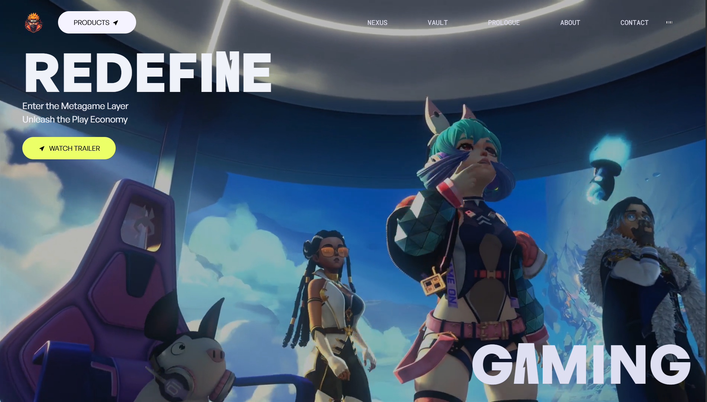

# Zentry — Gaming Website

An immersive, modern gaming website inspired by [Zentry](https://zentry.com/), built with React and GSAP. This project explores creative UI development through dynamic layouts, interactive elements, smooth animations, and visually engaging experiences.

## Preview



## 🔗 Links

- **Live Demo:** [View Website](YOUR_VERCEL_DEPLOYMENT_URL)
- **Original Website:** [Zentry](https://zentry.com/)

## ✨ Features

- **Immersive Hero Section** — Full-screen video backgrounds and interactive video transitions.
- **GSAP Animations** — Smooth animations and scroll-based effects powered by GSAP and ScrollTrigger.
- **Interactive Navigation** — Responsive desktop navigation and animated mobile menu.
- **Creative UI Interactions** — Custom hover effects, animated typography, and engaging visual elements.
- **Smooth Scrolling** — Enhanced scrolling experience using Locomotive Scroll.
- **Responsive Design** — Adapted layouts for desktop, tablet, and mobile devices.
- **Reusable Components** — Modular React components for cleaner and maintainable code.

## 🛠️ Tech Stack

- **React.js** — Component-based UI development
- **JavaScript** — Application logic and interactivity
- **Tailwind CSS** — Utility-first styling and responsive layouts
- **GSAP** — Advanced animations and transitions
- **GSAP ScrollTrigger** — Scroll-based animations
- **Locomotive Scroll** — Smooth scrolling experience
- **React Icons** — Icon library

## 🚀 Getting Started

Follow these steps to run the project locally.

### Prerequisites

- Node.js
- npm

### Installation

1. Clone the repository:

   ```bash
   git clone YOUR_REPOSITORY_URL
   ```

2. Navigate to the project directory:

   ```bash
   cd zentry-gaming-website
   ```

3. Install dependencies:

   ```bash
   npm install
   ```

4. Start the development server:

   ```bash
   npm run dev
   ```

5. Open the local URL provided by Vite in your browser.

## 🎯 Project Purpose

This project was developed to strengthen my frontend development skills through practical implementation of modern UI design, responsive layouts, reusable React components, and advanced animation techniques.

The goal was to recreate the visual experience and interactive feel of Zentry while focusing on clean component architecture, animation details, and responsive user experiences.

---

**An independent frontend project inspired by Zentry. All original branding, assets, and design concepts belong to their respective owners.**

Built with creativity and attention to detail.

— Abdullah